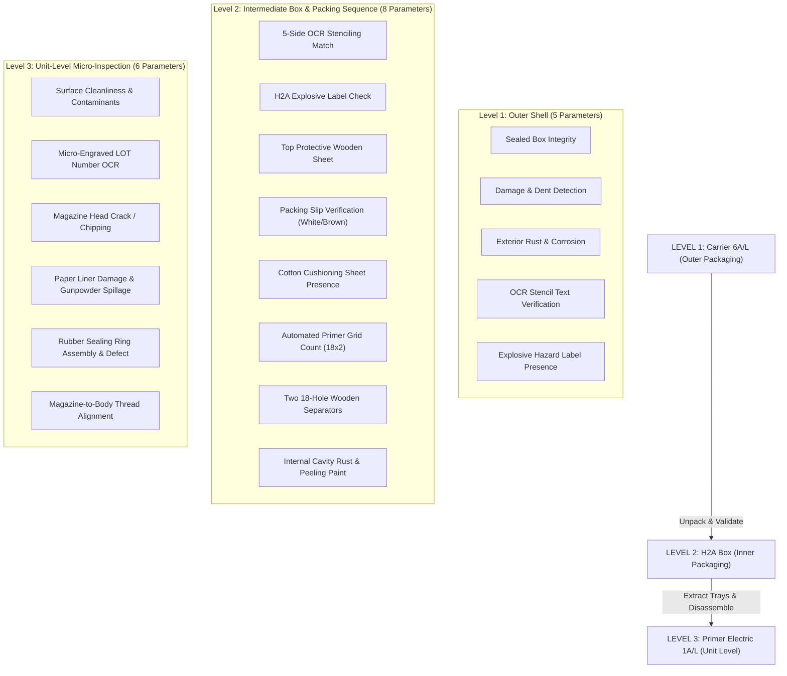
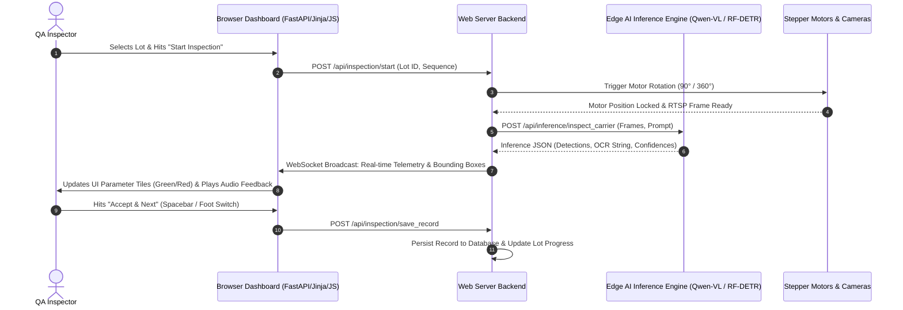

# Primer Electric 1A/L - AI Inspection Dashboard Specification
## Complete User Perspective & Client-Facing UI/UX Architecture

**Document Version:** 1.0.0  
**Target Product:** Primer Electric 1A/L & Associated Packaging (Carrier 6A/L & H2A Box)  
**System Type:** Defense-Grade Edge AI Visual Quality Assurance System  
**Prepared For:** Client Presentation, Demonstration & Operational Alignment  

---

## 1. Executive Summary & System Philosophy

This document outlines the complete user interface, content architecture, and operational behavior of the **Primer Electric 1A/L Automated Inspection Dashboard**. Designed specifically for defense-grade manufacturing and military arsenal quality assurance, the dashboard provides zero-defect validation across the complete 3-tier packaging and unit hierarchy.

### 1.1 The 3-Tier Inspection Hierarchy



### 1.2 Core Design & Operational Principles
1. **Operator Efficiency & Error Proofing (Poka-Yoke):** High-contrast industrial UI with distinct visual states (Inspecting, Pass, Reject, Attention Required). One-click progression and physical hardware button synchronization.
2. **Sub-Second Real-Time AI Telemetry:** Low-latency RTSP camera streams combined with real-time WebSocket state distribution. Inference overlays show precise bounding boxes, OCR confidence scores, and defect tags.
3. **Audit Trail & Military Standard Compliance:** Complete cryptographic traceability for every inspected lot, outer carrier, intermediate box, and individual primer unit with time-stamped camera snapshots, operator disposition, and exportable PDF/Excel certificates.

---

## 2. Global Navigation & Layout Framework

The application utilizes a persistent, dark industrial navigation sidebar coupled with an adaptive, information-dense operational workspace.

```
+-------------------------------------------------------------------------------------------------------------+
| [LOGO] ORDNANCE QA | PRIMER ELECTRIC 1A/L                    [CAM 1: ONLINE] [CAM 2: ONLINE] [USER: OP-04] |
+------------------+------------------------------------------------------------------------------------------+
|                  | BREADCRUMBS: Dashboard > Lot Inspection > Lot #PE-2026-088                               |
| [@] Dashboard    |------------------------------------------------------------------------------------------|
| [=] Manage Lots  |                                                                                          |
| [#] Count Units  |                                                                                          |
| [O] Inspect      |                               MAIN OPERATIONAL VIEWPORT                                  |
|     Carrier 6A/L |                          (Camera Feed, Parameters Grid,                                  |
| [o] Inspect      |                            Motor Controls, Dynamic Logs)                                 |
|     H2A Box      |                                                                                          |
| [*] Inspect      |                                                                                          |
|     Primer 1A/L  |                                                                                          |
| [^] Reports      |                                                                                          |
| [!] Hardware     |                                                                                          |
| [X] Logout       |                                                                                          |
+------------------+------------------------------------------------------------------------------------------+
```

### Persistent Elements Across All Pages:
- **Station Identity & Breadcrumbs:** Real-time indicator of current active Lot, Box, and Primer Sequence.
- **Hardware Status Pills:** Top-right live badges showing Camera connectivity (Top, Rotary, Macro) and Stepper Motor link status (`BOX_TURN_MOTOR`, `PRIMER_ROTARY_MOTOR`).
- **Emergency / Quick Stop:** Global physical button and on-screen interrupt listener to safely halt any active motorized rotation or capture loop.
- **Toast Notifications:** Non-blocking top-center toasts for operational feedback (e.g., *"Box #12 parameters verified: PASSED"*).

---

## 3. Detailed Page-by-Page Breakdown

---

### Page 1: Operator & Inspector Authentication (`/auth/login`)

#### Purpose
Restricted entry point ensuring only certified defense QA operators and supervisors can initiate inspections, calibrate models, or override AI decisions.

#### Visual Layout & Wireframe
```
+-----------------------------------------------------------------------------------------+
|                                                                                         |
|                               +-------------------------------+                         |
|                               |    [GOVERNMENT DEFENSE EMBLEM] |                         |
|                               |  PRIMER ELECTRIC 1A/L SYSTEM  |                         |
|                               |   Automated Vision QA Portal  |                         |
|                               +-------------------------------+                         |
|                               |                               |                         |
|                               | Operator ID / Email           |                         |
|                               | [ op-inspector@ordnance.gov ] |                         |
|                               |                               |                         |
|                               | Security PIN / Password       |                         |
|                               | [ ******************       ] |                         |
|                               |                               |                         |
|                               | Station Terminal              |                         |
|                               | [ Terminal 02 - Bay 4      v] |                         |
|                               |                               |                         |
|                               | [     AUTHENTICATE & ENTER  ] |                         |
|                               |                               |                         |
|                               | (•) Shift Logged: Morning 'A' |                         |
|                               +-------------------------------+                         |
|                                                                                         |
+-----------------------------------------------------------------------------------------+
```

#### Content Elements
- **Authentication Card:** Clean military aesthetic, defense organization badge, single-point sign-on.
- **Terminal Identifier:** Dropdown/Detection of physical workstation terminal and hardware bay.
- **Role-Based Access Control (RBAC):** Determines UI privileges (`Operator`, `Lead QA Inspector`, `System Administrator`).

#### Dynamic Behavior
- **Station Heartbeat:** Checks that connected edge AI server and cameras are reachable before granting dashboard access.
- **Session Locking:** Auto-locks after 15 minutes of inactivity during live inspection to prevent unauthorized sign-offs.

---

### Page 2: Operations Master Dashboard (`/user/dashboard`)

#### Purpose
The central command center providing immediate visibility into shift throughput, active lots, inspection queue statuses, and hardware operational readiness.

#### Visual Layout & Wireframe
```
+-------------------------------------------------------------------------------------------------------------+
| Welcome back, Inspector Sharma | Shift: Morning A | Station: QA-BAY-01                                      |
+-------------------------------------------------------------------------------------------------------------+
| [ STAT: CARRIER 6A/L ]       | [ STAT: H2A BOXES ]          | [ STAT: PRIMER UNITS ]    | [ ACTIVE LOTS ]    |
| 142 Inspected                | 568 Inspected                | 10,224 Inspected          | 3 In Progress      |
| [ 98.6% Acceptance Rate ]    | [ 99.1% Acceptance Rate ]    | [ 99.4% Acceptance Rate ] | [ 1 Pending Sign ] |
+-------------------------------------------------------------------------------------------------------------+
| ACTIVE INSPECTION PIPELINES (Carrier & Box Queues)           | HARDWARE & SENSOR HEALTH MATRIX              |
|--------------------------------------------------------------|----------------------------------------------|
| Lot No.        Type          Level      Status      Action   | (•) CAM 01: Top Carrier Cam    [ONLINE 30fps]|
| PE-2026-088    Primer 1A/L   Carrier    Inspecting  [RESUME] | (•) CAM 02: 360 Box Side Cam   [ONLINE 30fps]|
| PE-2026-087    Primer 1A/L   H2A Box    Pending     [START]  | (•) CAM 03: Unit Macro Cam     [ONLINE 30fps]|
| PE-2026-086    Primer 1A/L   Unit 1A/L  Inspecting  [RESUME] | (•) CAM 04: Overhead Count Cam [ONLINE 30fps]|
|                                                              | (•) MOTOR 1: Box Turntable     [CONNECTED]   |
| PRIMER UNIT INSPECTION PIPELINE                              | (•) MOTOR 2: Primer Rotary 360 [CONNECTED]   |
|--------------------------------------------------------------| (•) AI Server Core (Qwen-VL)   [LATENCY 68ms]|
| Lot No.        Sampling      Completed  Rejects     Action   | (•) Emergency Hardware Switch  [READY]       |
| PE-2026-086    315 Units     210 Units  1 Defect    [RESUME] |----------------------------------------------|
| PE-2026-085    315 Units     315 Units  0 Defects   [VIEW]   | Shift Yield Target: 12,000 Primers           |
|                                                              | Progress: [=====================>   ] 85.2%  |
+-------------------------------------------------------------------------------------------------------------+
```

#### Content & Functional Blocks
1. **Executive Metric Tiles:**
   - **Carrier 6A/L Counter:** Total outer boxes scanned this shift with pass/fail ratios.
   - **H2A Box Counter:** Total intermediate boxes verified.
   - **Primer Unit Counter:** Total individual primers inspected at micro-level.
   - **Active Lots:** Live lots pending inspection or supervisor sign-off.
2. **Actionable Inspection Tables:**
   - Real-time queue showing Lot Number, Hierarchy Level, Current Sequence, Status Badge (`Pending`, `Inspecting`, `Completed`), and direct contextual Action button (`Start`, `Resume`, `Review Report`).
3. **Live Hardware Telemetry Bar:**
   - Real-time status badges for all 4 camera streams (RTSP latency, FPS) and precision stepper motors.
   - Live AI Engine connection status and average inference round-trip time.

#### User Interactions
- Clicking **"Resume"** directly transports the operator into the exact sequence step of the active lot without data loss.
- Clicking on a hardware card opens the detailed camera stream & motor diagnostic drawer.

---

### Page 3: Ordnance Lot Management & Sampling Setup (`/user/manage_lots`)

#### Purpose
Enables QA supervisors to configure new production lots, specify declared quantities, select product variations (Primer Electric 1A/L), and set military sampling plans (MIL-STD-105E / Defense QA standards).

#### Visual Layout & Wireframe
```
+-------------------------------------------------------------------------------------------------------------+
| LOT MANAGEMENT & BATCH CONFIGURATION                                         [ + CREATE NEW ORDNANCE LOT ]  |
+-------------------------------------------------------------------------------------------------------------+
| SEARCH: [ Filter Lot # / Date...         ]  STATUS: [ All Statuses v]  PRODUCT: [ Primer Electric 1A/L v]   |
+----+--------------+-------------------+-------------+-------------------+---------------+-------------------+
| S# | Lot Number   | Product / Type    | Total Units | Sampling Size     | Status        | Actions           |
+----+--------------+-------------------+-------------+-------------------+---------------+-------------------+
| 01 | PE-2026-088  | Primer Elec 1A/L  | 20,000      | 100 Car / 315 Prm | Inspecting    | [OPEN] [DETAILS]  |
| 02 | PE-2026-087  | Primer Elec 1A/L  | 10,000      | 50 Car / 200 Prm  | Pending       | [START INSPECT]   |
| 03 | PE-2026-086  | Primer Elec 1A/L  | 20,000      | 100 Car / 315 Prm | Completed     | [CERTIFICATE/PDF] |
| 04 | PE-2026-085  | Primer Elec 1A/L  | 15,000      | 75 Car / 250 Prm  | Completed     | [CERTIFICATE/PDF] |
+----+--------------+-------------------+-------------+-------------------+---------------+-------------------+

+----------------------- [MODAL: CREATE NEW ORDNANCE LOT] ---------------------------------------------------+
| Lot Number:              [ LOT-PE-2026-089                                              ]                   |
| Product Type:            [ Primer Electric 1A/L                                       v]                   |
| Packaging Structure:     [ Carrier 6A/L (Outer) -> Box H2A (Inner) -> Primer 1A/L     v]                   |
| Total Batch Quantity:    [ 20,000 Primers                                               ]                   |
| Box Breakdown:           [ 555 H2A Boxes (36 per box) | 185 Carrier 6A/L (3 H2A / Car)  ]                   |
| QA Sampling Plan:        [ Level II Normal Inspection (MIL-STD-105E)                  v]                   |
| Target Sampling Count:   [ Carrier: 20 Boxes | H2A: 60 Boxes | Primer Units: 315 Units  ]                   |
| Inspector In-Charge:     [ Sharma, V. (ID: OP-04)                                       ]                   |
|                                                                                                             |
|                                                             [ CANCEL ]   [ INITIALIZE & GENERATE QUEUE ]    |
+-------------------------------------------------------------------------------------------------------------+
```

#### Content Elements & Fields
- **Master Lots Table:** Tabular display of Lot ID, Creation Timestamp, Assigned Inspector, Inspection Progress (Carrier %, H2A Box %, Primer Unit %), Acceptance Status (`Pending`, `Passed`, `Rejected`).
- **Interactive Lot Creation Modal:**
  - Auto-computes expected box counts based on packing rules (36 Primers per H2A Box, 3 H2A Boxes per Carrier 6A/L).
  - Configures MIL-STD sampling quotas automatically.

#### Dynamic Behavior
- Pre-populates the 3 inspection queues (Carrier $\rightarrow$ H2A $\rightarrow$ Primer Unit) upon initialization.
- Validates lot numbering format against military factory stenciling conventions.

---

### Page 4: Pallet & Unit Counting Verification Station (`/user/count_boxes_and_fuzes`)

#### Purpose
Employs wide-angle ceiling-mounted cameras and AI object detection (RF-DETR) to automatically count pallets of Carrier 6A/L outer boxes, stacked H2A boxes, or primers in tray grids, eliminating manual counting errors.

#### Visual Layout & Wireframe
```
+-------------------------------------------------------------------------------------------------------------+
| AUTOMATED COUNTING STATION: Lot #PE-2026-088 | Target: Carrier 6A/L Pallet Stack                            |
+------------------------------------------------------------------+------------------------------------------+
| LIVE OVERHEAD AI VISION FEED (CAM 04: COUNT_ROOF_TOP)            | COUNTING VERIFICATION TELEMETRY          |
| +--------------------------------------------------------------+ |------------------------------------------|
| |  [REC]   AI DETECTIONS: 24 BOXES DETECTED       FPS: 30      | | Current Lot:        PE-2026-088          |
| | +-----+ +-----+ +-----+ +-----+ +-----+ +-----+              | | Count Target:       Carrier 6A/L         |
| | |[#01]| |[#02]| |[#03]| |[#04]| |[#05]| |[#06]|              | | Expected Count:     24 Boxes             |
| | +-----+ +-----+ +-----+ +-----+ +-----+ +-----+              | |------------------------------------------|
| | +-----+ +-----+ +-----+ +-----+ +-----+ +-----+              | | AI DETECTED COUNT:  24 BOXES             |
| | |[#07]| |[#08]| |[#09]| |[#10]| |[#11]| |[#12]|              | | CONFIDENCE:         99.4%                |
| | +-----+ +-----+ +-----+ +-----+ +-----+ +-----+              | | STATUS:             [ MATCH CONFIRMED ]  |
| | +-----+ +-----+ +-----+ +-----+ +-----+ +-----+              | |------------------------------------------|
| | |[#13]| |[#14]| |[#15]| |[#16]| |[#17]| |[#18]|              | | Operator Override (If Discrepancy):      |
| | +-----+ +-----+ +-----+ +-----+ +-----+ +-----+              | | [ 24                        ] [ADJUST]   |
| | +-----+ +-----+ +-----+ +-----+ +-----+ +-----+              | |------------------------------------------|
| | |[#19]| |[#20]| |[#21]| |[#22]| |[#23]| |[#24]|              | | [ RE-COUNT / RE-TRIGGER SNAPSHOT ]       |
| | +-----+ +-----+ +-----+ +-----+ +-----+ +-----+              | |                                          |
| +--------------------------------------------------------------+ | [ CONFIRM COUNT & PROCEED TO INSPECTION ]|
+------------------------------------------------------------------+------------------------------------------+
```

#### Content Elements & Behavior
- **Overhead High-Res Video:** Real-time stream highlighting detected containers with numbered bounding boxes.
- **Count Delta Verification:** Compares the AI detected count against the shipment dispatch docket.
- **One-Click Confirmation:** If the count matches, the operator clicks **"Confirm Count"** to lock the batch count and automatically enable the sequential inspection stations.

---

### Page 5: Level 1 - Carrier 6A/L Outer Box Inspection Station (`/user/inspect_carrier`)

#### Purpose
Executes Level 1 QA on the heavy outer metal Carrier 6A/L containers. Controls the turntable motor to inspect all sides and top surface across **Parameters 1 to 5**.

#### Visual Layout & Wireframe
```
+-------------------------------------------------------------------------------------------------------------+
| CARRIER 6A/L INSPECTION | Lot: PE-2026-088 | Box: #03 of 20 (Sampling Queue)           [ < PREV ] [ NEXT > ]|
+------------------------------------------------------------------+------------------------------------------+
| LIVE TURNTABLE FEED (CAM 01/02: TOP & SIDE 360°)   [• REC]       | PARAMETER ACCEPTANCE STATUS (PARAMS 1-5) |
| +--------------------------------------------------------------+ |------------------------------------------|
| |                                                              | | [x] 1. Sealed Box Integrity      [PASSED]|
| |   [ BOUNDING BOX: STENCIL OCR VALIDATED ]                    | |     • Sealing wire & clip present & taut |
| |   Detected: "PRIMER ELEC 1A/L - LOT 88 - 2026"               | | [x] 2. Damage & Dents            [PASSED]|
| |   Confidence: 98.7%                                          | |     • No surface deformation detected    |
| |                                                              | | [x] 3. Exterior Rust / Paint     [PASSED]|
| |   [ BOUNDING BOX: HAZARD LABEL CONFIRMED ]                   | |     • Surface corrosion < 0.1% (Allowed) |
| |   Class 1.4S Explosive Sticker - Properly Aligned            | | [x] 4. OCR Stencil Accuracy      [PASSED]|
| |                                                              | |     • Stencil matched Lot PE-2026-088    |
| |                                                              | | [x] 5. Explosive Label Presence  [PASSED]|
| |                                                              | |     • 1.4S sticker intact on Side-1      |
| +--------------------------------------------------------------+ |------------------------------------------|
| STEPPER MOTOR TURNTABLE CONTROLS                                 | OVERALL CARRIER VERDICT: [ PASSED ]      |
| [ Rotate 180° ] [ Rotate 90° ] [ Jog 10° ] [ Jog 5° ] [ Jog 1° ] | Operator Override: [ Pass v]             |
|------------------------------------------------------------------+------------------------------------------|
| REAL-TIME TELEMETRY & INFERENCE LOG STREAM                       | SEQUENCE CONTROLS:                       |
| 16:42:01 - Turntable rotated 90° to Side A                       | [ PAUSE ]  [ STOP ]  [ RE-INSPECT BOX ]  |
| 16:42:02 - Qwen-VL: Sealed box wire verified (Confidence: 0.99)  |                                          |
| 16:42:03 - RF-DETR: Stenciling matches specification template    | [ SAVE CARRIER & PROCEED TO NEXT (ENTER)]|
+------------------------------------------------------------------+------------------------------------------+
```

#### Content & Parameter Mapping (Parameters 1 to 5)
1. **Param 1: Sealed Box:** AI verifies presence, tension, and intactness of the outer metal sealing wire and lead seal.
2. **Param 2: Damage Box:** AI detects structural dents, corner crushing, gouges, or severe metal deformation.
3. **Param 3: Rusty Box:** AI evaluates surface oxidation, paint chipping, and corrosion percentage against military tolerance.
4. **Param 4: Incorrect Stenciling:** OCR reads military lot number, ammunition designation, and manufacturer code, matching against database specification.
5. **Param 5: Explosive Label Missing:** Object detector verifies presence, correct orientation, and legibility of the standard explosive class diamond hazard label.

#### Interactive Behavior
- **Automated Sequence:** Pressing **"Start Inspection"** triggers the turntable through four 90-degree rotations, acquiring snapshots and running the 5 parameter models automatically in under 6 seconds.
- **Defect Alerting:** If any parameter fails (e.g., Stencil mismatch), the UI flashes a high-contrast amber/red alert banner, logs the exact defect timestamp, and prompts the operator for physical reinspection or rejection confirmation.

---

### Page 6: Level 2 - H2A Box Inner Packaging Station (`/user/inspect_h2a_box`)

#### Purpose
Guides the operator through opening the H2A intermediate metal ammunition container and systematically validating the internal packaging layers across **Parameters 6 to 13**.

#### Visual Layout & Wireframe
```
+-------------------------------------------------------------------------------------------------------------+
| H2A BOX INSPECTION | Lot: PE-2026-088 | Box H2A: #07 of 60 | Sequence Step: 4 of 6 (Grid Counting)          |
+------------------------------------------------------------------+------------------------------------------+
| CAMERA VIEW (CAM 01: MACRO OVERHEAD)               [• REC]       | STEP-BY-STEP PACKAGING WORKFLOW CHECKLIST|
| +--------------------------------------------------------------+ |------------------------------------------|
| |                                                              | | (V) STEP 1: 5-Side Stenciling & Label    |
| |   AI COUNTING GRID: 36/36 PRIMERS DETECTED                   | |     • Params 6 & 7: OCR & Label [PASSED] |
| |   [X][X][X][X][X][X]  Row 1: 6 Primers                       | | (V) STEP 2: Top Wooden Sheet             |
| |   [X][X][X][X][X][X]  Row 2: 6 Primers                       | |     • Param 8: Top Sheet Present[PASSED] |
| |   [X][X][X][X][X][X]  Row 3: 6 Primers                       | | (V) STEP 3: Packing Slip & Cotton Sheet  |
| |   [X][X][X][X][X][X]  Row 4: 6 Primers                       | |     • Param 9: Slip Color (Brown)[PASSED]|
| |   [X][X][X][X][X][X]  Row 5: 6 Primers                       | |     • Param 10: Cotton Sheet    [PASSED] |
| |   [X][X][X][X][X][X]  Row 6: 6 Primers                       | | (>) STEP 4: Primer Quantity Counting     |
| |                                                              | |     • Param 11: Count = 36/36   [PASSED] |
| |   Confidence: 99.8% | Zero Missing Cavities                  | | ( ) STEP 5: Two 18-Hole Wooden Sheets    |
| |                                                              | |     • Param 12: 18-Holes Tray   [WAITING]|
| +--------------------------------------------------------------+ | ( ) STEP 6: Internal Rust & Peeling Paint|
| INSTRUCTION: "Remove cotton cushioning and verify primer grid"   |     • Param 13: Cavity Walls    [WAITING]|
|------------------------------------------------------------------+------------------------------------------|
| CURRENT STEP TELEMETRY:                                          | WORKFLOW ACTION CONTROLS:                |
| Grid Count: 36 of 36 present | Arrangement: 6x6 Matrix           | [ < PREVIOUS STEP ]  [ RE-CAPTURE STEP ] |
| Missing Primers: 0 | Misaligned Caps: 0                          |                                          |
| Elapsed Step Time: 1.8s                                          | [ CONFIRM STEP & PROCEED (NEXT) -> ]     |
+------------------------------------------------------------------+------------------------------------------+
```

#### Content & Parameter Step Sequence (Parameters 6 to 13)
The UI dynamically steps through the unpacking stages:
- **Step 1 (Params 6 & 7):** Exterior 5-Side Stenciling OCR & Explosive Hazard Label.
- **Step 2 (Param 8):** AI detects presence and condition of the top solid protective wooden sheet.
- **Step 3 (Params 9 & 10):** AI verifies presence of the Packing Slip (classifying paper color as White or Brown per lot specification) and verifies the Cotton Cushioning Sheet.
- **Step 4 (Param 11):** High-precision counting model validates that all 36 primer slots in the tray are occupied.
- **Step 5 (Param 12):** Verifies the two internal wooden separator fixtures with exactly 18 holes each.
- **Step 6 (Param 13):** Inspects internal box cavity walls for interior rust, bare metal corrosion, or flaking/peeling green paint.

#### Interactive Behavior
- As the inspector lifts each packaging layer, the live camera detects the new layer, automatically triggers the corresponding prompt sequence, checks off the item, and illuminates green indicators on the step timeline.

---

### Page 7: Level 3 - Primer Electric 1A/L Unit Inspection Station (`/user/inspect_primer`)

#### Purpose
The micro-inspection station. Inspects individual Primer Electric 1A/L units mounted on the high-resolution 360-degree optical rotary jig across **Parameters 14 to 19**.

#### Visual Layout & Wireframe
```
+-------------------------------------------------------------------------------------------------------------+
| PRIMER ELECTRIC 1A/L UNIT QA | Lot: PE-2026-088 | Unit: #42 of 315 (Sampled Units)      [ AUTO-ROTATE 360° ]|
+------------------------------------------------------------------+------------------------------------------+
| HIGH-MAGNIFICATION MACRO OPTICAL FEED (CAM 03)     [• REC 60fps] | UNIT QUALITY ACCEPTANCE (PARAMS 14-19)   |
| +--------------------------------------------------------------+ |------------------------------------------|
| |                                                              | | [x] 14. Cleanliness & Surface    [PASSED]|
| |   [ ZOOM: 4X MACRO VIEW OF MAGAZINE HEAD & LINER ]           | |     • Clean metallic luster, no oil/dust |
| |                                                              | | [x] 15. Micro Lot Engraving OCR  [PASSED]|
| |     (A) LOT NO: "1A/L-088-26"   [OCR CONFIRMED 99.2%]        | |     • Body Engraving matches Lot 088     |
| |     (B) RUBBER RING: SEATED & INTACT                         | | [x] 16. Magazine Crack / Damage  [PASSED]|
| |     (C) PAPER LINER: INTACT (NO GUNPOWDER SPILLAGE)          | |     • Zero hairline cracks on head       |
| |     (D) THREAD SEATING GAP: 0.12mm (TOLERANCE: < 0.20mm)     | | [x] 17. Paper Liner & Powder Leak[PASSED]|
| |                                                              | |     • Paper intact; 0 powder granules    |
| |                                                              | | [x] 18. Rubber Sealing Ring      [PASSED]|
| +--------------------------------------------------------------+ |     • Seated in groove, no tears/crimps  |
| MULTI-ANGLE CAPTURE GALLERY (360° Inspection Snapshots)         | [x] 19. Magazine Assembly Alignment[PASSED]|
| [ Angle 0° (V) ] [ Angle 90° (V) ] [ Angle 180° (V) ] [ Top (V) ]|     • Thread pitch aligned, 0.12mm gap   |
|------------------------------------------------------------------+------------------------------------------|
| JIG MOTOR STEPPER: [ 360° Full Scan ] [ 90° Angle ] [ 5° Jog ]   | UNIT QA VERDICT: [ ACCEPTED - PASS ]     |
| UNIT BARCODE: PE1AL-088-0042                                     | Override Reason: [ None (AI Match) v]    |
| INSPECTION DURATION: 1.4 Seconds                                 |------------------------------------------|
|                                                                  | [ REJECT UNIT ]  [ RE-SCAN 360° ]        |
|                                                                  | [ ACCEPT & LOAD NEXT PRIMER (SPACE) -> ] |
+------------------------------------------------------------------+------------------------------------------+
```

#### Content & Parameter Inspection Details (Parameters 14 to 19)
1. **Param 14: Cleanliness Appearance:** Detects surface grease, oil spots, metal burrs, dust, or foreign particle contamination on the primer brass/aluminum body.
2. **Param 15: Lot Number Micro-OCR:** Reads the laser-engraved/stamped miniature lot number on the primer perimeter, verifying exact string and font consistency.
3. **Param 16: Magazine Crack/Damage:** High-resolution edge detection for hairline fractures, edge chipping, or impact deformations on the primer magazine cap.
4. **Param 17: Paper Liner Damage & Gunpowder Spillage:** Verifies that the internal moisture-proof protective paper liner is unbroken and that zero propellant/gunpowder granules have leaked onto the rim.
5. **Param 18: Rubber Ring Absence/Damage:** Confirms that the elastomer sealing ring is present, seated fully inside its machined groove, and free from cuts, twists, or crimping.
6. **Param 19: Magazine Assembly Alignment:** Validates correct mechanical assembly of the magazine head onto the primer body, measuring the thread gap and tilt angle to ensure proper hermetic seating.

#### Interactive Behavior
- **One-Touch Automated Rotary Scan:** Inspector mounts the primer and taps the foot switch or on-screen button. The jig executes a rapid 360° rotation, captures 4 cardinal micro-images, evaluates all 6 parameters simultaneously via Qwen-VL, and signals PASS/REJECT in **under 1.5 seconds**.

---

### Page 8: Lot Audit, Multi-Level Inspection Details & QA Acceptance (`/admin/manage_lots/lot_details` / `/user/lot_details`)

#### Purpose
Provides deep forensic review and supervisor sign-off for a completed or in-progress lot. Allows QA leads to drill down into any individual Carrier, H2A Box, or Primer Unit, reviewing all recorded camera frames, OCR extractions, and AI confidence telemetry.

#### Visual Layout & Wireframe
```
+-------------------------------------------------------------------------------------------------------------+
| LOT AUDIT DOSSIER: Lot #PE-2026-088 | Primer Electric 1A/L                    [ EXPORT INSPECTION DOSSIER ] |
+-------------------------------------------------------------------------------------------------------------+
| LOT SUMMARY OVERVIEW                                                                                        |
| Created: 2026-08-21 08:30 | Inspector: Sharma, V. | Total Lot Size: 20,000 Units | Status: COMPLETED (PASS) |
| Carriers Inspected: 20/20 (100% Pass) | H2A Boxes: 60/60 (100% Pass) | Primer Units: 315/315 (99.68% Pass)  |
+-------------------------------------------------------------------------------------------------------------+
| DRILL-DOWN INSPECTION HIERARCHY TABS                                                                        |
| [ LEVEL 1: CARRIER 6A/L (20) ]  [ LEVEL 2: H2A BOXES (60) ]  [ LEVEL 3: PRIMER UNITS (315) ]                |
+-------------------------------------------------------------------------------------------------------------+
| FILTER UNITS: [ Show All v]  RESULT: [ All v]  SEARCH SERIAL/BOX: [                     ]                   |
|                                                                                                             |
| > BOX CARRIER #01 - PASSED [Params 1-5: ALL CLEAR] [View 4 Snapshots] [Download Telemetry]                 |
| > BOX CARRIER #02 - PASSED [Params 1-5: ALL CLEAR] [View 4 Snapshots] [Download Telemetry]                 |
| v BOX CARRIER #03 - PASSED WITH OPERATOR OVERRIDE                                                           |
|   +-------------------------------------------------------------------------------------------------------+ |
|   | Parameter                  | AI Verdict | Confidence | Operator Override | Timestamp | Evidence   | |
|   | 1. Sealed Box Integrity    | PASS       | 99.4%      | -                 | 09:12:04  | [View JPG] | |
|   | 2. Damage & Dents          | PASS       | 98.1%      | -                 | 09:12:05  | [View JPG] | |
|   | 3. Rust & Corrosion        | AMBER(0.8%)| 91.2%      | ACCEPTED (Sharma) | 09:12:05  | [View JPG] | |
|   | 4. Stencil OCR             | PASS       | 99.8%      | -                 | 09:12:06  | [View JPG] | |
|   | 5. Hazard Explosive Label  | PASS       | 99.7%      | -                 | 09:12:06  | [View JPG] | |
|   +-------------------------------------------------------------------------------------------------------+ |
| > BOX CARRIER #04 - PASSED [Params 1-5: ALL CLEAR]                                                          |
| ...                                                                                                         |
+-------------------------------------------------------------------------------------------------------------+
| FINAL SUPERVISOR LOT ACCEPTANCE DECISION:                                                                   |
| Status: [ ACCEPT & ISSUE DISPATCH CLEARANCE (PASSED)                                                   v]   |
| Sign-off Comments: "All 19 parameters verified across 3 sampling tiers in accordance with MIL-STD-105E."   |
| Digital Signature: [ SIGN & CERTIFY LOT DOSSIER ]                                                          |
+-------------------------------------------------------------------------------------------------------------+
```

#### Content Elements
- **Hierarchical Accordion Structure:** Allows expanding any Carrier $\rightarrow$ its enclosed H2A Boxes $\rightarrow$ sampled Primer units.
- **Evidence Inspection Modal:** High-resolution zoomable image carousel showing raw capture vs. AI bounding box overlay.
- **Audit Logging:** Records every manual override, inspector ID, and rationale for defense compliance.

---

### Page 9: Automated QA Inspection Reports & Export Engine (`/reports`)

#### Purpose
Generates official, print-ready defense QA certificates, detailed Excel parameter matrices, and complete cryptographic ZIP archives containing all inspection metadata and raw image files.

#### Visual Layout & Wireframe
```
+-------------------------------------------------------------------------------------------------------------+
| INSPECTION REPORT GENERATION & COMPLIANCE EXPORT CENTER                                                     |
+-------------------------------------------------------------------------------------------------------------+
| SELECT LOT: [ Lot #PE-2026-088 - Primer Electric 1A/L (20,000 Units)                                      v] |
+-------------------------------------------------------------------------------------------------------------+
| AVAILABLE REPORT ARTIFACTS & FORMATS                                                                        |
|                                                                                                             |
| [ PDF ICON ]  OFFICIAL CERTIFICATE OF QUALITY CONFORMANCE (CQAE / DEFENCE QA FORMAT)                        |
|               • Executive QA Summary, Level 1/2/3 Acceptance Tables, Digital Signatures, Pass/Fail Verdict  |
|               [ PREVIEW IN BROWSER ]   [ DOWNLOAD PDF (.pdf) ]                                              |
|                                                                                                             |
| [ XLS ICON ]  MASTER 19-PARAMETER INSPECTION MATRIX (EXCEL SPREADSHEET)                                     |
|               • Tab 1: Lot Header & Sampling Quantities                                                     |
|               • Tab 2: Carrier 6A/L Telemetry (Params 1-5)                                                  |
|               • Tab 3: Box H2A Telemetry (Params 6-13, 5-Side Stencils, Tray Counts)                        |
|               • Tab 4: Primer Electric 1A/L Micro-Inspection (Params 14-19, OCR Strings, Thread Gaps)       |
|               [ DOWNLOAD COMPLETE EXCEL (.xlsx) ]                                                           |
|                                                                                                             |
| [ ZIP ICON ]  COMPLETE LOT EVIDENCE BATCH ARCHIVE (ZIP DOSSIER)                                             |
|               • Full JSON/CSV Raw Telemetry Logs                                                            |
|               • High-Resolution Image Captures for All Inspected Boxes & Units with Bounding Box Annotations|
|               • PDF QA Certificate & Excel Spreadsheet                                                      |
|               [ GENERATE & STREAM ZIP BUNDLE (.zip) ]                                                       |
+-------------------------------------------------------------------------------------------------------------+
```

#### Content & Formatting Highlights
- **PDF Certificate:** Standardized defense documentation layout with official seal, batch reference, test results for all 19 parameters, defect counters, and authorized signature blocks.
- **Excel Report:** Multi-tab workbook with structured column layouts formatted for institutional archival and ERP import.

---

### Page 10: Multi-Camera Live Surveillance & Hardware Diagnostic Matrix (`/admin/cameras`, `/admin/surveillance`)

#### Purpose
Dedicated to maintenance engineers and station leads to monitor the 4 live optical streams in real time, fine-tune PTZ camera settings, adjust lighting brightness, and run motor homing cycles.

#### Visual Layout & Wireframe
```
+-------------------------------------------------------------------------------------------------------------+
| HARDWARE SURVEILLANCE & OPTICAL CALIBRATION MATRIX                                                          |
+--------------------------------------------------------------+----------------------------------------------+
| CAM 01: CARRIER TOP & WIRE SEAL (RTSP / 1080p @ 30fps)       | CAM 02: 360° BOX ROTARY (RTSP / 1080p @ 30fps) |
| +----------------------------------------------------------+ | +------------------------------------------+ |
| | [LIVE FEED - TURNTABLE TOP VIEW]                         | | | [LIVE FEED - SIDE STENCILING VIEW]       | |
| | Status: Active | Exposure: 1/250s | Focus: Locked        | | | Status: Active | Exposure: 1/300s | Focus: OK | |
| +----------------------------------------------------------+ | +------------------------------------------+ |
| CAM 03: PRIMER MACRO OPTICAL SENSOR (RTSP / 4K @ 60fps)      | CAM 04: CEILING PALLET COUNT (RTSP / 1080p)  |
| +----------------------------------------------------------+ | +------------------------------------------+ |
| | [LIVE FEED - 4X MACRO ROTARY JIG]                        | | | [LIVE FEED - OVERHEAD WIDE ANGLE]        | |
| | Status: Active | Ring Light: 85% | Focus: 42.1mm         | | | Status: Active | Exposure: Auto | Wide-FOV | |
| +----------------------------------------------------------+ | +------------------------------------------+ |
+--------------------------------------------------------------+----------------------------------------------+
| HARDWARE JOG & CALIBRATION DOCK                                                                             |
| Stepper Motor 1 (Turntable): [ HOME ] [ +90° ] [ -90° ] [ CALIBRATE ZERO ] | Current Pos: 0.00° [READY]     |
| Stepper Motor 2 (Primer Jig): [ HOME ] [ +360° TEST ] [ JOG 1° ]            | Current Pos: 0.00° [READY]     |
| LED Illumination Ring:      [ MIN <=====================O===> MAX (85%) ]                                   |
+-------------------------------------------------------------------------------------------------------------+
```

---

## 4. Master 19-Parameter Visual Verification Reference

| # | Parameter Name | Hierarchy Level | Visual UI Representation | AI Model / Technique | Acceptance Criteria |
|---|---|---|---|---|---|
| **1** | **Sealed Box** | Carrier 6A/L | Green/Red wire seal badge on Top Cam | Qwen-VL Prompt / Detector | Sealing wire present, unsevered, and locked |
| **2** | **Damage Box** | Carrier 6A/L | Surface heatmap overlay on 3D Box view | RF-DETR Anomaly Detector | Zero structural dents > 5mm depth or punctures |
| **3** | **Rusty Box** | Carrier 6A/L | Rust % surface area progress indicator | Texture Segmentation Model | Exterior rust area < 1.0% of total surface |
| **4** | **Incorrect Stenciling** | Carrier 6A/L | Side-by-side OCR text comparison card | Qwen-VL Micro-OCR | Stencil text matches Lot ID and NATO/Govt code |
| **5** | **Explosive Label Missing**| Carrier 6A/L | Diamond hazard icon tag on box corner | RF-DETR Object Detector | Class 1.4S hazard sticker present & upright |
| **6** | **5-Side Stenciling** | Box H2A | 5-Tab thumbnail carousel (Top/F/B/L/R) | Qwen-VL 5-Side Sequence | All 5 sides conform to approved stencil format |
| **7** | **Explosive Label** | Box H2A | Hazard label presence indicator | RF-DETR Object Detector | Hazard sticker verified on intermediate box |
| **8** | **Wooden Sheet (Top)** | Box H2A | Step 2 Layer presence checkmark | Qwen-VL Visual Prompt | Top solid wooden buffer plate present & unbroken |
| **9** | **Packing Slip** | Box H2A | Color badge (White/Brown) & OCR read | Qwen-VL Prompt + Classifier | Slip present; paper color matches specification |
| **10**| **Cotton Sheet** | Box H2A | Cushioning layer presence checkmark | Qwen-VL Visual Prompt | Cotton cushioning layer present across all slots |
| **11**| **Primer Quantity Count**| Box H2A | 6x6 Matrix Grid with individual slot tags| RF-DETR Counting Model | Exactly 36/36 primers detected (Zero missing) |
| **12**| **Wooden Sheet (18-Holes)**| Box H2A | Dual-tray 18-hole verification tags | Qwen-VL Visual Prompt | Two 18-hole wooden separator trays confirmed |
| **13**| **Interior Rust / Paint** | Box H2A | Internal cavity surface anomaly map | Surface Anomaly Detector | Zero flaking paint or internal cavity oxidation |
| **14**| **Cleanliness Appearance**| Primer 1A/L | High-res surface contaminant heatmap | Qwen-VL Surface Prompt | Clean brass/aluminum luster, 0 grease/debris |
| **15**| **Micro Lot Number OCR** | Primer 1A/L | Magnified text strip with character diff | Ultra-Macro OCR Engine | Engraved lot code matches batch master exactly |
| **16**| **Magazine Crack/Damage** | Primer 1A/L | Magnified rim bounding box | Edge & Crack Detector | Zero cracks, chips, or dents on magazine rim |
| **17**| **Paper Liner & Powder** | Primer 1A/L | Paper liner integrity circle + powder dot | High-Res Color Classifier | Paper liner intact; 0 powder leakage detected |
| **18**| **Rubber Ring Seating** | Primer 1A/L | Annular contour line around groove | Contour & Defect Model | Rubber ring present, seated in groove, undamaged |
| **19**| **Magazine Assembly** | Primer 1A/L | Thread seating gap measurement (mm) | Metric Caliper Vision Model | Thread gap within 0.05mm - 0.20mm tolerance |

---

## 5. Client Demonstration Flow & Operational Scenarios

When demonstrating this dashboard to military clients, factory supervisors, or procurement boards, the following 5-step demonstration narrative provides the most impactful user experience:

### Scenario Walkthrough for Client Presentation:
1. **Lot Setup & Pallet Ingestion (2 Minutes):**
   - Show how quickly a new lot (`PE-2026-089`) is registered.
   - Point the overhead camera at a pallet; show the system counting 24 outer boxes automatically with 100% accuracy.
2. **Carrier 6A/L Outer Inspection (3 Minutes):**
   - Place a Carrier on the turntable. Hit **"Start Inspection"**.
   - Watch the turntable rotate smoothly as the AI detects the seal wire, reads the stenciling via OCR, and validates the explosive hazard label in under 6 seconds.
   - *Simulate Defect:* Introduce a box with a missing hazard sticker or incorrect stencil; show the instant red alert banner and operator override options.
3. **Box H2A Guided Unpacking Sequence (4 Minutes):**
   - Demonstrate the intuitive step-by-step layer workflow.
   - Show how the AI recognizes each physical layer (Wooden sheet $\rightarrow$ Packing slip color $\rightarrow$ Cotton sheet $\rightarrow$ 36-primer grid count) as the operator unboxes.
4. **Primer Electric 1A/L Micro-Inspection (3 Minutes):**
   - Place an individual primer in the 360° macro rotary jig.
   - Hit the scan trigger; show the sub-1.5s multi-angle rotation, micro-OCR lot reading, rubber ring inspection, and paper liner spillage check.
5. **One-Click Audit Dossier & Certificate Export (2 Minutes):**
   - Navigate to the Lot Audit Dossier.
   - Download the generated **Certificate of Conformance PDF** and **Complete Excel 19-Parameter Report** with embedded evidence photos.

---

## 6. System Technical Architecture & Data Exchange



---

## 7. Summary & Next Steps

This document represents the complete, end-to-end design and operational blueprint for the **Primer Electric 1A/L AI Quality Assurance Dashboard**. The proposed architecture addresses all 19 mandatory inspection parameters, guarantees compliance with defense QA requirements, and delivers a modern, intuitive, zero-defect inspection workflow for operators and supervisors.
